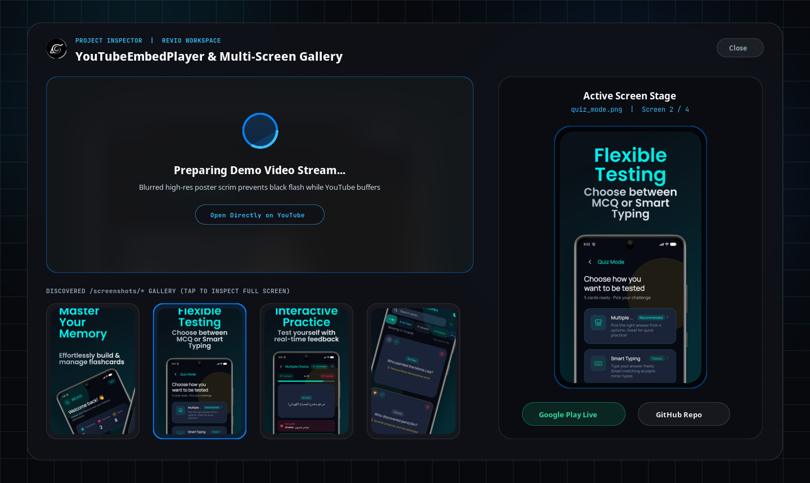
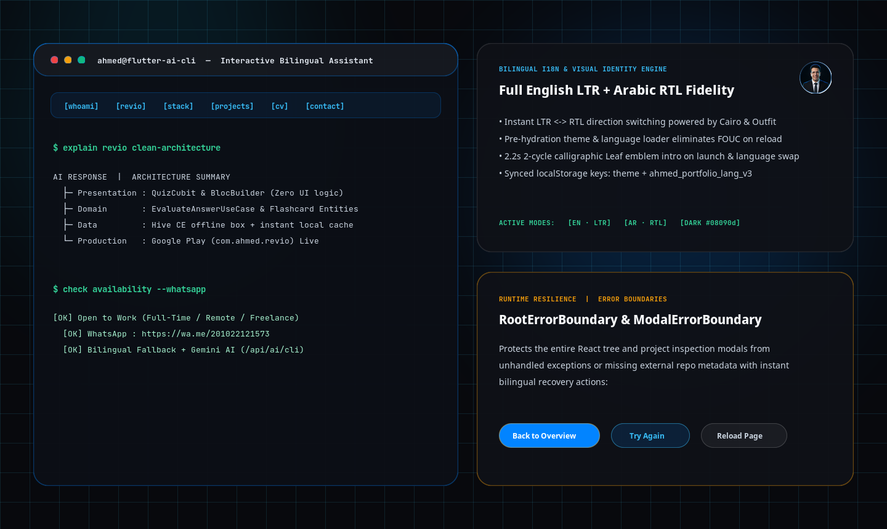

<div align="center">


# Ahmed El-Bialy — Developer Portfolio

**Bilingual (English LTR / Arabic RTL) · Dark & Light Theme · React 19 · TypeScript · Tailwind CSS v4 · Express**

<br/>


<br/><br/>

[](https://ahmed-el-bialy.vercel.app)
[](https://play.google.com/store/apps/details?id=com.ahmed.revio)
[](https://wa.me/201022121573)
[](mailto:ah.elbialy.dev@gmail.com)
[](https://www.linkedin.com/in/ahmedel-bialy/)
[](https://github.com/ahmed-el-bialy)
[](https://www.youtube.com/@AhmedEl-Bialy)
[](https://www.tiktok.com/@ahmedelbialydev)

</div>

---

## 🌐 About the Website

A responsive, bilingual (**English LTR** & **Arabic RTL**) full-stack developer portfolio for **Ahmed El-Bialy** (Flutter Mobile Developer), built with **React 19**, **TypeScript**, **Vite 8**, **Tailwind CSS v4**, and an **Express** server. Engineered with Obsidian Dark & Light themes, pre-hydrated direction/theme switching, staggered GPU-safe scroll reveals, a redesigned interactive project inspection workspace, and resilient live-API fallback caching.

---

## ✨ Key Features

- **Bilingual EN / AR RTL Engine:** Instant switching between English (`LTR`, `Outfit` / `Plus Jakarta Sans` / `JetBrains Mono`) and Arabic (`RTL`, `Cairo`) via pre-hydration scripts preventing flash of wrong theme or direction.
- **Dark & Light Design System:** Unified design tokens (`src/styles/tokens.css`) across Obsidian Dark (`#08090d`) and Crisp Light (`#f8fafc`) surfaces with subtle 4% architectural grid canvas, consistent magnetic buttons, and `prefers-reduced-motion` support.
- **Focused Hero & Interactive Revio Stage:** 3-KPI hero architecture (`Google Play` Live App, `Public Repositories`, `Clean Architecture`), unified quick-contact/social controls, and a crisp interactive smartphone preview stage.
- **Redesigned Project Inspection Workspace (`ProjectDetailsModal`):**
  - **Balanced Split Overview & Media Stage:** 6/12 editorial brief with a **2×2 Quick Technical Summary** paired with an interactive `Video Demo` / `App Screens` phone stage (`YouTubeEmbedPlayer` with blurred poster preloader).
  - **Full-Width 3-Column Spec Matrix:** Dedicated 12/12 specification strip detailing Category & Scope, Architecture & State, and Distribution & Release.
  - **Fullscreen Video + Screenshot Lightbox:** Unified fullscreen viewer supporting seamless RTL-aware arrow navigation (`ArrowLeft` / `ArrowRight`) across both video walkthroughs and mobile screenshots.
  - **Deep-Link Project Sharing (`?project=<repoName>`):** Direct project URLs with one-click **Copy Link** support and clean URL state management.
  - **Gallery, Architecture & Study Cases:** Categorized screenshot gallery, interactive architecture/data-flow inspector, and bilingual `CASE_STUDY.md` / `CASE_STUDY_AR.md` rendering.
- **Smart Live Data Sync & Fallback Pipeline:** Express backend proxies (`/api/github/*`, `/api/playstore/app`, `/api/parse-cv`, `/api/ai/chat`) paired with TanStack React Query v5, `localStorage` caching, and curated fallback data (`githubService` + `projectLinks`).
- **Interactive Bilingual AI CLI & Modals:** Built-in developer terminal (`TerminalEasterEggModal`, triggered from the footer or by typing `ahmed`), live-synced print/PDF CV viewer (`ResumeModal`), consultation scheduler (`BookingMeetingModal`), and `RootErrorBoundary` / `ModalErrorBoundary` recovery screens.
- **Responsive Across Viewports:** Staggered `RevealOnScroll` motion and tuned spacing across mobile (with bottom navigation dock), tablet, and desktop layouts.

---

## 🖼️ Website UI Preview

<table>
  <tr>
    <td width="50%" valign="top">
      <h4 align="center">🎬 Project Stage, Video Player & Gallery</h4>
      
    </td>
    <td width="50%" valign="top">
      <h4 align="center">⚡ Bilingual CLI, Arabic RTL & Recovery UI</h4>
      
    </td>
  </tr>
</table>

---

## 🛠️ Tech Stack

| Layer | Technologies |
| :--- | :--- |
| **Frontend** | React 19, TypeScript, Vite 8, Tailwind CSS v4 |
| **Motion & UI** | Framer Motion / Motion, Lucide React, Shiki Code Highlighter, Custom SVG Leaf Boot Sequence |
| **Data & Caching** | TanStack React Query v5, Local Cache + Curated Fallback Data Resolver |
| **Backend Server** | Node.js, Express (`server.ts`), TSX, API Proxy, Webhook Sync & Static Asset Serving |

---

## 📂 Project Structure

```text
├── public/                 # Brand marks, favicons, OG preview cards, and showcase assets
├── src/
│   ├── components/         # Page sections, Hero stage, ProjectDetailsModal, CLI & ErrorBoundaries
│   ├── context/            # Theme, Toast, and bilingual EN/AR RTL context providers
│   ├── data/               # Portfolio copy, bilingual translations, config, and curated project data
│   ├── hooks/              # Accessible dialog, scroll lock, keyboard, and reveal hooks
│   ├── services/           # GitHub, Play Store, CV parser, and booking services
│   ├── styles/             # Design tokens and animation primitives (tokens.css)
│   ├── utils/              # Clipboard, project links, README extractor, and tech tag utilities
│   ├── App.tsx             # Multi-view shell, deep-link routing, and lazy modal orchestration
│   ├── main.tsx            # React root bootstrap
│   └── index.css           # Global Tailwind v4 setup and theme utilities
├── server.ts               # Express server + Vite dev middleware & API endpoints
├── index.html              # HTML entry, pre-hydration theme/RTL scripts, SEO & OG meta tags
├── tsconfig.json           # TypeScript compiler configuration
└── package.json            # Development, lint, build, and start scripts
```

---

## ⚡ Running Locally

```bash
npm install
npm run dev
```

Type-check, build, and run in production mode:

```bash
npm run lint    # TypeScript check (tsc --noEmit)
npm run build   # Build Vite production bundle
npm start       # Start Express server on port 3000
```

---

## 📬 Contact

- **Portfolio:** [ahmed-el-bialy.vercel.app](https://ahmed-el-bialy.vercel.app)
- **Revio (Google Play):** [com.ahmed.revio](https://play.google.com/store/apps/details?id=com.ahmed.revio)
- **WhatsApp:** [+20 102 212 1573](https://wa.me/201022121573)
- **Email:** [ah.elbialy.dev@gmail.com](mailto:ah.elbialy.dev@gmail.com)
- **LinkedIn:** [linkedin.com/in/ahmedel-bialy](https://www.linkedin.com/in/ahmedel-bialy/)
- **GitHub:** [@ahmed-el-bialy](https://github.com/ahmed-el-bialy)
- **YouTube:** [@AhmedEl-Bialy](https://www.youtube.com/@AhmedEl-Bialy)
- **TikTok:** [@ahmedelbialydev](https://www.tiktok.com/@ahmedelbialydev)
