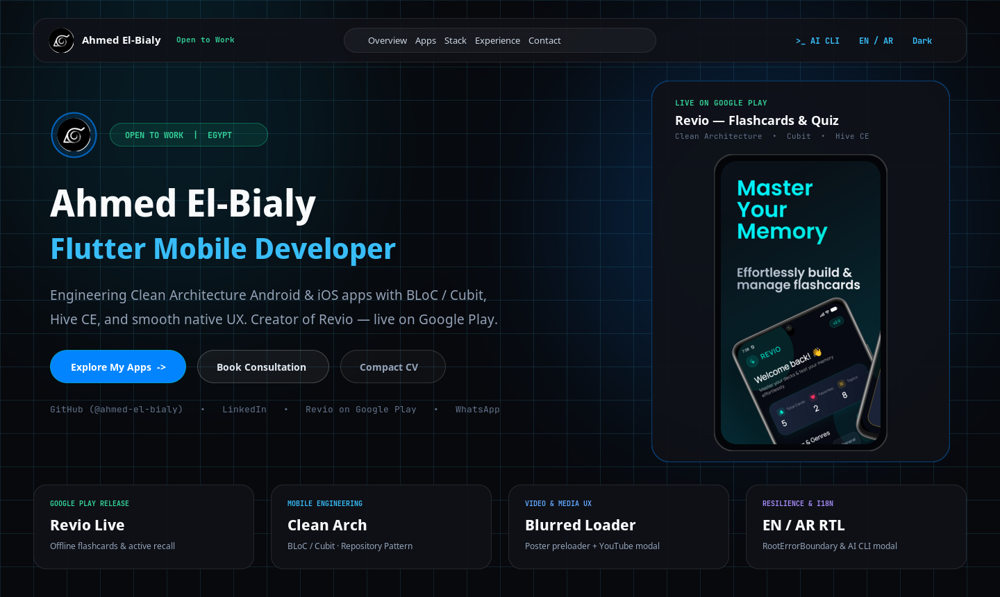
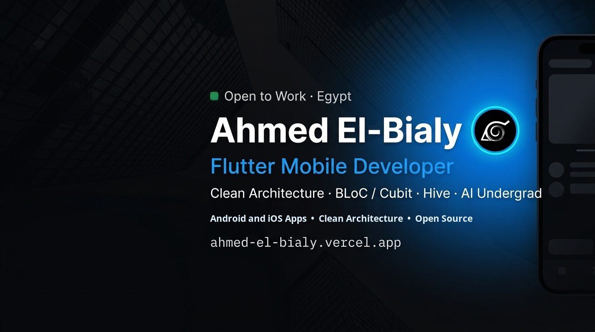

<div align="center">


# Ahmed El-Bialy — Flutter Mobile Developer Portfolio

**Cross-Platform Android & iOS Engineering • Clean Architecture • BLoC / Cubit • Hive CE • Live on Google Play**

<br/>



<br/><br/>

[](https://ahmed-el-bialy.vercel.app/)
[](https://play.google.com/store/apps/details?id=com.ahmed.revio&hl=en_US)
[](https://drive.google.com/file/d/1lQMnmyIA100YyXLu4jqFdhWluSeig4Pn/view)
[](https://github.com/ahmed-el-bialy)
[](https://www.linkedin.com/in/ahmedel-bialy/)
[](https://www.youtube.com/@AhmedEl-Bialy)
[](https://www.tiktok.com/@ahmedelbialydev)
[](mailto:ah.elbialy.dev@gmail.com)
[](https://wa.me/201022121573)

</div>

---

## 📱 Portfolio Overview

Official web portfolio of **Ahmed El-Bialy** — Flutter Mobile Developer (Open to Work) and Artificial Intelligence undergraduate at the **Faculty of Artificial Intelligence, Kafrelsheikh University** (`Oct 2023 – Jun 2027`).

Engineered as a bilingual (**English LTR / Arabic RTL**) full-stack React 19 + Express showcase combining a **Name-First Hero Stage**, **live Google Play Store metrics** for *Revio*, **automatic GitHub repository, `/screenshots/*` gallery & README discovery**, a **2.2s 2-cycle calligraphic Leaf boot sequence**, a **blurred-poster `YouTubeEmbedPlayer` + in-app `VideoDemoModal`**, **`RootErrorBoundary` & `ModalErrorBoundary` crash recovery shields**, an **interactive bilingual Developer AI CLI**, an **Executive 2-Column Digital CV** with isolated print/PDF export, and a **2-step Cal.com consultation pipeline**.

---

## 🖼️ Website UI & Feature Visuals

### Hero Stage, Live Play Store Proof & Overview KPIs


<br/>

<table>
  <tr>
    <td width="50%" valign="top">
      <h4 align="center">🎬 Blurred-Poster Video Preloader & Screen Stage</h4>
      
      <p><sub><code>YouTubeEmbedPlayer</code> eliminates black video flash with a blurred <code>hqdefault.jpg</code> poster scrim + 4.5s direct fallback, paired with interactive <code>/screenshots/*</code> inspection.</sub></p>
    </td>
    <td width="50%" valign="top">
      <h4 align="center">⚡ Bilingual AI CLI, RTL Engine & Error Boundaries</h4>
      
      <p><sub>Interactive bilingual Gemini AI CLI (with offline fallback), pre-hydrated English LTR / Arabic RTL theme switching, and <code>RootErrorBoundary</code> crash shields.</sub></p>
    </td>
  </tr>
</table>

---

## 🎨 Personal Brand Visual Pack (LinkedIn · GitHub · WhatsApp)

Ready-to-use brand assets engineered to match the portfolio's `#08090d` dark-studio theme, electric-blue rim lighting (`#0284ff` / `#00c7ff`), and signature white-brush Leaf emblem:


  <tr>
    <td width="66%" align="center" valign="top">
      
      <br/>
      <strong>Wide Profile Cover Banner</strong><br/>
      <sub><code>./public/profile-banner.jpg</code><br/>Designed with bottom-left avatar safe zone for LinkedIn & GitHub headers</sub>
 
  </tr>


### 🔗 OpenGraph & WhatsApp / LinkedIn Link Preview Card (`1200×630`)

Configured in `index.html` (`?v=12`) so every shared link on **WhatsApp**, **LinkedIn**, and **X/Twitter** renders a rich studio preview card featuring Ahmed's portrait, **Open to Work · Flutter & AI** badge, *Revio* Play Store mention, and Leaf mark:

<div align="center">
  
</div>

---

## 🚀 Live Applications & Production Builds

| Application | Engineering Highlights | Core Stack | Live Links & Demos |
| :--- | :--- | :--- | :--- |
| <br/>**Revio** *(Flagship)* | 🌟 **Published Live on Google Play**<br/>Offline-first flashcard & active-recall learning app featuring 3D matrix flip cards, interactive MCQ/smart-typing quizzes, and zero-latency local persistence | Clean Architecture, Flutter, Dart, Cubit, Hive CE | [Google Play](https://play.google.com/store/apps/details?id=com.ahmed.revio&hl=en_US) • [Download APK](https://github.com/ahmed-el-bialy/Revio/releases/download/v1.0.0/app-release.apk) • [Watch Demo](https://youtube.com/shorts/FsG1XUAbmDY?si=lvngji7Uz-EKRROJ) • [GitHub](https://github.com/ahmed-el-bialy/Revio) |
| <br/>**Movura** | 🎬 **Movie & Series Discovery Client**<br/>TMDB API integration with Sliver parallax headers, shimmer skeletons, debounced real-time search & embedded YouTube trailers | Clean Architecture, Flutter, BLoC & Cubit, Dio, TMDB API | [Watch Demo](https://youtube.com/shorts/9LCJqMSuZno?si=b-7WUOXY8B0IUahe) • [Full Demo](https://youtube.com/playlist?list=PLGHDB4nGr8K0&si=Bro9Uai9p9glcGuQ) • [GitHub](https://github.com/ahmed-el-bialy/Movura) |
| <br/>**Vibrant-Store** | 🛒 **E-Commerce Marketplace**<br/>Real-time product catalog powered by DummyJSON API with category chip filtering, wishlist & persistent cart state | Flutter, Dart, Service Layer Pattern, REST API, Cubit | [Watch Demo](https://youtube.com/shorts/PIg1rYA0CkQ) • [GitHub](https://github.com/ahmed-el-bialy/Vibrant-store) |
| <br/>**Sky-Cast** | ⛅ **Climate-Adaptive Weather App**<br/>Atmospheric gradients synced dynamically to live forecasts with custom Flutter `SearchDelegate` city autocomplete | Clean Architecture, Flutter, WeatherAPI, SearchDelegate | [Watch Demo](https://youtube.com/shorts/u5JjIphdrAM?si=h44HWlZMZki8L_GM) • [GitHub](https://github.com/ahmed-el-bialy/Sky-Cast) |
| <br/>**News-Cloud** | 📰 **Bilingual News Aggregator**<br/>Categorized breaking headlines with full Arabic RTL/LTR fidelity and distraction-free in-app WebView reading | Repository Pattern, Flutter, Retrofit, Dio, Arabic RTL | [Watch Demo](https://youtube.com/shorts/AKbiBjCRIis) • [GitHub](https://github.com/ahmed-el-bialy/News-Cloud) |
| <br/>**Shaats** | 💬 **Real-Time Cloud Messenger**<br/>Instant chat built on Firebase Auth sessions and bidirectional Cloud Firestore reactive snapshot streams | Flutter, Dart, Firebase Auth, Cloud Firestore, Streams | [GitHub](https://github.com/ahmed-el-bialy/Shaats) |

### Additional Open-Source Builds

- **Nihon-Seed** — Interactive Hiragana/Katakana audio flashcard trainer • [GitHub](https://github.com/ahmed-el-bialy/Nihon-Seed) • [Watch Demo](https://youtube.com/shorts/OG-S_8oSN00?si=1K0SkiW8voSb4YR-)
- **NBN-Basketball** — Real-time courtside scoreboard & match timer • [GitHub](https://github.com/ahmed-el-bialy/NBN-Basketball) • [Watch Demo](https://youtube.com/shorts/xJaE0pxSpAQ?si=8lF-9tGR68cHibaL)
- **piano-tunes** — Custom neon-glow musical synthesizer • [GitHub](https://github.com/ahmed-el-bialy/piano-tunes) • [Watch Demo](https://youtube.com/shorts/9PWzO0_ozQ0)
- **Quotely** — Minimal dark quotes client built with Retrofit + Dio + Cubit • [GitHub](https://github.com/ahmed-el-bialy/Quotely) • [Watch Demo](https://youtube.com/shorts/Ujw3TKIyTPU?si=YQkRMt36eOruCWhS)
- **Note-Keep** — Lightweight local notes & task organizer • [GitHub](https://github.com/ahmed-el-bialy/Note-Keep)

---

## 💻 High-Fidelity Architecture Snippets

Clean separation between **Presentation (Cubit/BLoC)**, **Domain (Use Cases & Contracts)**, and **Data (Hive Local Storage & Dio/Retrofit APIs)** powers every production build showcased on `RevioShowcaseStage`.

### 1. Presentation Layer — State Evaluation (`Revio · quiz_cubit.dart`)

```dart
class QuizCubit extends Cubit<QuizState> {
  final EvaluateAnswerUseCase evaluateAnswer;
  final SaveProgressUseCase saveProgress;

  QuizCubit({
    required this.evaluateAnswer,
    required this.saveProgress,
  }) : super(const QuizInitial());

  Future<void> submitAnswer(String input, Flashcard card) async {
    final result = evaluateAnswer(
      userInput: input.trim(),
      expected: card.answer,
    );
    await saveProgress(card.id, isCorrect: result.isMatch);
    emit(QuizEvaluated(card: card, result: result));
  }
}
```

### 2. Data Layer — Zero-Latency Local Source (`Revio · flashcard_local_source.dart`)

```dart
abstract interface class FlashcardLocalSource {
  Future<List<FlashcardModel>> getDeckCards(String topicId);
  Future<void> upsertCard(FlashcardModel card);
}

class HiveFlashcardSource implements FlashcardLocalSource {
  final Box<FlashcardModel> _box;
  HiveFlashcardSource(this._box);

  @override
  Future<List<FlashcardModel>> getDeckCards(String topicId) async =>
      _box.values.where((c) => c.topicId == topicId).toList();

  @override
  Future<void> upsertCard(FlashcardModel card) =>
      _box.put(card.id, card);
}
```

### 3. Repository Pattern & Typed Failures (`Movura · tmdb_repository_impl.dart`)

```dart
class TmdbRepositoryImpl implements MediaRepository {
  final TmdbRemoteDataSource remote;
  TmdbRepositoryImpl(this.remote);

  @override
  Future<Either<Failure, List<MediaEntity>>> fetchTrending() async {
    try {
      final response = await remote.getTrendingMovies();
      return Right(response.results.map((m) => m.toEntity()).toList());
    } on DioException catch (err) {
      return Left(NetworkFailure.fromDio(err));
    }
  }
}
```

---

## 🛠️ Tech Stack Summary

### Mobile Engineering Stack
| Domain | Technologies & Patterns |
| :--- | :--- |
| **Core & Language** | Flutter SDK, Dart, Null Safety, Responsive Adaptive UI, RTL/LTR Localization |
| **Architecture** | Clean Architecture (Data / Domain / Presentation), Repository Pattern, Service Layer, SOLID |
| **State Management** | BLoC, Cubit, Reactive Streams, `BlocSelector` / `BlocConsumer` |
| **Networking & Data** | Dio, Retrofit (Code Generation), TMDB API, WeatherAPI, DummyJSON API |
| **Local & Cloud Storage** | Hive (`hive_ce`), SharedPreferences, SQLite, Firebase Auth, Cloud Firestore |
| **Release & Tooling** | Google Play Console, Signed AAB / APK Releases, Git / GitHub Actions |

### Portfolio Web Stack (`my-portfolio`)
| Layer | Technologies |
| :--- | :--- |
| **Frontend** | React 19, TypeScript, Vite, Tailwind CSS v4 |
| **Motion & UI** | Framer Motion (`motion`), Custom SVG Calligraphic Mask (`LeafAnimation`), Shiki Highlighter, Lucide React |
| **Video & Resilience** | `YouTubeEmbedPlayer` (Blurred Poster + Preloader), `VideoDemoModal`, `RootErrorBoundary`, `ModalErrorBoundary` |
| **Data & Caching** | TanStack React Query v5, Smart `README.md` & `/screenshots/*` Auto-Discovery, Dual-Mode Static + Proxy Sync |
| **Backend Proxy** | Express (`server.ts`), TSX, Google Play & Consolidated GitHub Caching, Google GenAI SDK (`/api/ai/cli`) |

---

## ✨ Key Portfolio Capabilities

1. **Name-First Hero, Glowing Blue-Ringed Floating Leaf & `RevioShowcaseStage`:** Pairs Ahmed's floating Leaf emblem inside a subtle cyan ring beside his name with a focused interactive *Revio* mobile showcase, balanced CTAs (**Explore My Apps · Book Consultation · Compact CV**), and live Play Store & GitHub KPI telemetry.
2. **Blurred-Poster `YouTubeEmbedPlayer` & In-App `VideoDemoModal`:** Eliminates black flash frames while YouTube embeds buffer by displaying a blurred high-res `hqdefault.jpg` poster scrim with a localized loading spinner, `180ms` post-load crossfade, and `4.5s` direct YouTube fallback action — wired uniformly across Hero Showcase, Overview cards, and Projects cards.
3. **Global `RootErrorBoundary` & `ModalErrorBoundary` Recovery:** Wraps the root application in `main.tsx` and project inspection views (`ProjectDetailsModal`) with safe try-catch sanitization and a bilingual Dark/Light recovery screen (**Back to Overview**, **Try Again**, **Reload Page**).
4. **2.2s Calligraphic Self-Drawing Leaf Loader (`LeafAnimation`):** Unbordered 3-stroke calligraphy sequence tracing the Leaf emblem from the inner spiral coil out to the triangle base and final tip flick (`2` crisp drawing cycles over `2.2s`), synchronized across initial site load (`OpeningBootOverlay`), section navigation, and EN/AR RTL language toggles.
5. **Full Arabic RTL & English AI-Powered Developer CLI (`TerminalEasterEggModal`):** Responsive mobile bottom sheet and desktop terminal with dynamic `RTL`/`LTR` direction, one-tap command chips (`whoami`, `stack`, `revio`, `projects`, `experience`, `contact` + Arabic equivalents), and Gemini AI Q&A with instant offline fallback.
6. **100% Automatic Cover & Screen Auto-Discovery (`ProjectCardCover` + `/api/github/portfolio`):** Automatically inspects `/screenshots/*` (`cover.png/jpg/webp` + interactive phone screen thumbnails) and embedded `README.md` imagery for any pushed GitHub repository.
7. **Executive 2-Column Digital CV (`ResumeModal`) & Guided Consultation (`BookingMeetingModal`):** Instant toggle between formatted 2-column CV (with isolated `@media print` export) and Google Drive PDF viewer, plus a 2-step Cal.com booking pipeline with WhatsApp & Gmail fallbacks.

---

## 📂 Repository Structure

```text
├── public/
│   ├── brand-logo-mark.png          # Circular white brush Leaf emblem
│   ├── favicon.svg / .ico / .png    # Synchronized browser tab & Apple touch icons
│   ├── profile-avatar.jpg           # 1:1 dark-studio avatar for LinkedIn / GitHub / WhatsApp
│   ├── profile-banner.jpg           # Wide cover banner for LinkedIn & GitHub headers
│   ├── og-image.jpg / .png          # 1200x630 OpenGraph link-share card (v=12)
│   ├── website-poster.png           # Portfolio Hero & Live KPI showcase banner
│   ├── showcase-workspace.png       # Video preloader & multi-screen inspector showcase
│   └── showcase-bilingual-cli.png   # AI CLI, Arabic RTL engine & ErrorBoundary visual
├── src/
│   ├── components/                  # React 19 UI, Hero stage, LeafAnimation, YouTubeEmbedPlayer, ErrorBoundaries, CLI & modals
│   ├── context/                     # Bilingual EN/AR state & coordinated RTL/LTR curtain switching
│   ├── data/                        # Single source of truth config, Dart snippets, translations & projects
│   ├── services/                    # Consolidated GitHub client, auto-screenshot scanner, README parser & Play Store hook
│   └── utils/                       # Smart demo button classifier & repository tech tag extractor
├── server.ts                        # Express + Vite server (/api/github/portfolio, /api/playstore/app, /api/ai/cli)
├── index.html                       # Unified favicons, OpenGraph v=12 cards & Schema.org JSON-LD
└── package.json                     # Build, dev, lint & start scripts
```

---

## ⚡ Getting Started

```bash
git clone https://github.com/ahmed-el-bialy/my-portfolio.git
cd my-portfolio
npm install
npm run dev
```

Verify TypeScript types and production bundle:

```bash
npm run lint    # tsc --noEmit
npm run build   # Vite production bundle
npm start       # Express production server on port 3000
```

---

## 🎓 Verified Credentials

- **Faculty of Artificial Intelligence, Kafrelsheikh University** — B.Sc. in Artificial Intelligence (`Oct 2023 – Jun 2027`)
- **CodeAlpha** — Flutter Development Trainee (`Jun 2026 – Jul 2026`)
- **Sprints × Microsoft Summer Camp** — Mobile Development (`Jun 2025 – Jul 2025`) • [Certificate](https://sprints.ai/ar-eg/journeys/learning/ID%20-%20SPR%20-%20JC9327/view-certificate-serial)
- **Udemy Complete Flutter & Dart Development** (`Apr 2026`) • [Certificate](https://www.udemy.com/certificate/UC-46b0d9a2-bf8f-4398-ae93-d3b9e54b9063/)

---

## 📬 Direct Channels

- **Portfolio:** [ahmed-el-bialy.vercel.app](https://ahmed-el-bialy.vercel.app/)
- **Resume / CV PDF:** [View & Download CV](https://drive.google.com/file/d/1lQMnmyIA100YyXLu4jqFdhWluSeig4Pn/view)
- **Google Play:** [Revio on Google Play Store](https://play.google.com/store/apps/details?id=com.ahmed.revio&hl=en_US)
- **WhatsApp / Phone:** [+20 102 212 1573](https://wa.me/201022121573)
- **Email:** [ah.elbialy.dev@gmail.com](mailto:ah.elbialy.dev@gmail.com)
- **LinkedIn:** [linkedin.com/in/ahmedel-bialy](https://www.linkedin.com/in/ahmedel-bialy/)
- **GitHub:** [@ahmed-el-bialy](https://github.com/ahmed-el-bialy)
- **YouTube:** [@AhmedEl-Bialy](https://www.youtube.com/@AhmedEl-Bialy)
- **TikTok:** [@ahmedelbialydev](https://www.tiktok.com/@ahmedelbialydev)

<div align="center">
  <sub>Engineered by Ahmed El-Bialy • © 2026 All Rights Reserved</sub>
</div>
