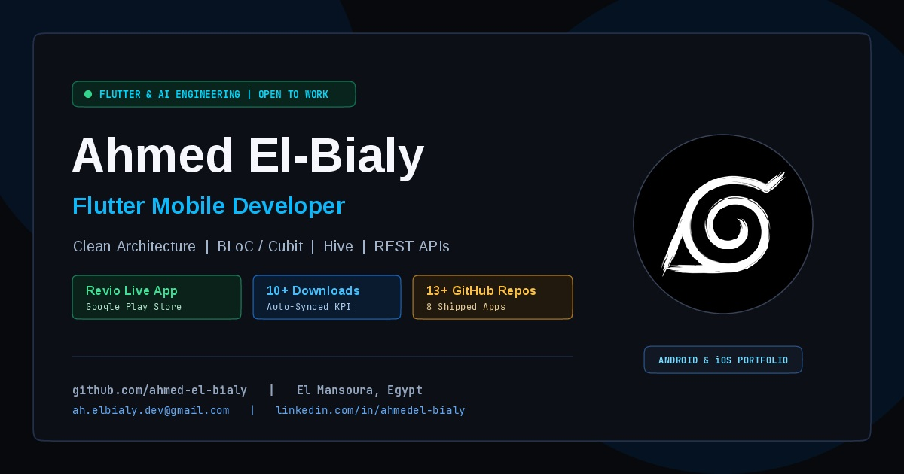

# Ahmed El-Bialy — Flutter Mobile Developer Portfolio

<div align="center">


[](https://ahmed-el-bialy.vercel.app/)
[](https://play.google.com/store/apps/details?id=com.ahmed.revio&hl=en_US)
[](https://github.com/ahmed-el-bialy)
[](https://www.linkedin.com/in/ahmedel-bialy/)
[](https://www.youtube.com/@AhmedEl-Bialy)
[](mailto:ah.elbialy.dev@gmail.com)
[](https://wa.me/201022121573)

<p align="center">
  <strong>Cross-Platform Flutter &amp; Dart Engineering • Clean Architecture • Live Google Play &amp; GitHub Sync • Bilingual EN/AR</strong>
</p>

</div>

---

## 📱 Overview

Official full-stack portfolio of **Ahmed El-Bialy** — Flutter Mobile Developer and undergraduate at the **Faculty of Artificial Intelligence, Kafrelsheikh University**.

Built as a high-craft product showcase combining an Express + Vite backend proxy with a kinetic React 19 UI: live **Google Play** stats sync for *Revio*, real-time **GitHub** repository telemetry, interactive app screenshot galleries, a **2-column Executive Digital CV** with isolated print export, and a guided **Cal.com** consultation pipeline.

---

## 📸 Featured Mobile Applications

<div align="center">

| Application | Highlights & Engineering Scope | Stack & Patterns | Links |
| :--- | :--- | :--- | :--- |
| <br/>**Revio** | 🌟 **Published on Google Play**<br/>Offline-first flashcard & active-recall learning app with 3D flip mechanics and interactive quiz mode | Clean Architecture, Flutter, Dart, Cubit, Hive, Google Play | [Google Play](https://play.google.com/store/apps/details?id=com.ahmed.revio&hl=en_US) • [GitHub](https://github.com/ahmed-el-bialy/Revio) • [Watch Demo](https://youtube.com/shorts/FsG1XUAbmDY) |
| <br/>**Movura** | 🎬 **Movie & Series Discovery**<br/>TMDB API client featuring Sliver parallax headers, shimmer loading, debounced search & YouTube trailers | Clean Architecture, Flutter, BLoC & Cubit, Dio, TMDB API | [GitHub](https://github.com/ahmed-el-bialy/Movura) • [Watch Demo](https://youtube.com/shorts/9LCJqMSuZno?si=b-7WUOXY8B0IUahe) • [Full Demo](https://youtube.com/playlist?list=PLGHDB4nGr8K0&si=Bro9Uai9p9glcGuQ) |
| <br/>**Vibrant-Store** | 🛒 **E-Commerce Marketplace**<br/>Real-time catalog browsing from DummyJSON API with category chip filtering, wishlist & persistent cart | Flutter, Dart, Service Layer Pattern, REST API, State Management | [GitHub](https://github.com/ahmed-el-bialy/Vibrant-store) • [Watch Demo](https://youtube.com/shorts/PIg1rYA0CkQ) |
| <br/>**Sky-Cast** | ⛅ **Climate-Adaptive Weather**<br/>Dynamic atmospheric palettes synced to forecasts with custom `SearchDelegate` city autocomplete | Clean Architecture, Flutter, WeatherAPI, SearchDelegate | [GitHub](https://github.com/ahmed-el-bialy/Sky-Cast) • [Watch Demo](https://youtube.com/shorts/u5JjIphdrAM) |
| <br/>**News-Cloud** | 📰 **Bilingual News Wire**<br/>Categorized global headlines with full Arabic RTL/LTR layout fidelity and distraction-free in-app WebView | Repository Pattern, Flutter, Retrofit, Dio, Arabic RTL | [GitHub](https://github.com/ahmed-el-bialy/News-Cloud) • [Watch Demo](https://youtube.com/shorts/AKbiBjCRIis) |
| <br/>**Shaats** | 💬 **Real-Time Messenger**<br/>Instant cloud chat powered by Cloud Firestore reactive snapshot streams and Firebase Auth sessions | Flutter, Dart, Firebase Auth, Cloud Firestore, Streams | [GitHub](https://github.com/ahmed-el-bialy/Shaats) |

</div>

> **Additional Open-Source Builds:** [Nihon-Seed](https://github.com/ahmed-el-bialy/Nihon-Seed) (gamified Kana & audio learning) and [NBN-Basketball](https://github.com/ahmed-el-bialy/NBN-Basketball) (courtside scoreboard & match clock).

---

## 🔗 Link Share Preview (`og:image`)

Optimized `1200×630` social share card configured for **LinkedIn**, **WhatsApp**, and **X/Twitter** link previews:

<div align="center">
  
</div>

---

## 🚀 Key Engineering Features

### 1. 📊 Hero Showcase Stage & Live Google Play Proxy (`/api/playstore/app`)
- **Name-First Editorial Hierarchy:** Leads directly with Ahmed's luminous Leaf brand emblem, **Ahmed El-Bialy**, and **Flutter Mobile Developer** title paired with clean Clean Architecture positioning.
- **Interactive `RevioShowcaseStage`:** Dual-panel device preview combining a live interactive *Revio* flashcard screen with Shiki syntax-highlighted Dart Clean Architecture code (`quiz_cubit.dart`, `flashcard_local_source.dart`, `tmdb_repository_impl.dart`).
- **Live Google Play Synchronization:** Server-side Express endpoint scrapes & caches live **Revio Rating**, **Downloads (`10+`)**, and release freshness cleanly on a 1-hour TTL with zero exposed API keys.
- **4-Card Color-Coded KPI Bento:** Dedicated **Revio ★ Rating**, **Play Downloads**, **GitHub Repositories (`13+`)**, and **Shipped Apps (`8+`)** cards powered by 3D cursor tilt (`TiltCard`).

### 2. 📱 Hero-First Screenshot Covers & Smart Demo Resolution
- **Crisp App UI Previews (`ProjectCardCover`):** Displays high-contrast mobile screens immediately in a 2-column Hero-first frame with clickable numbered thumbnails (`01..04`) and quick cover toggle—no need to open modals just to inspect the UI.
- **Smart Action Resolution (`SmartDemoButtons`):** Merges verified `portfolioData.ts` metadata with live GitHub `README.md` extraction, automatically labeling single demo videos as **Watch Demo**, full video series as **Full Demo**, plus direct **Google Play** and verified `.apk` release links.

### 3. 🧑‍💻 Structured Experience, Credentials & Developer Sync HUD
- **5-Tier Credential Cards (`ExperienceSection`):** Clean visual hierarchy separating **Issuer & Track → Title → Core Engineering Advantage → Skill Chips → Credential Verification Link**, eliminating cramped card density.
- **Consolidated GitHub Proxy (`/api/github/portfolio`):** Reduces client requests to a single 10-minute cached backend aggregation endpoint fetching repos, raw READMEs, release `.apk` assets, stack breakdown, and a **30-day commit activity heatmap** with offline snapshot fallback.
- **Filterable Stack Matrix (`StackSection`):** Interactive search and category tabs highlighting verified technologies with expandable sub-capabilities.

### 4. 📄 Executive 2-Column Digital CV & Isolated Print Export (`ResumeModal`)
- **Seamless Mode Switching:** Toggle cleanly between an executive **2-Column Digital CV** (Work Timeline + Technical Skills sidebar + Verified Certifications + Education) and the **Native Google Drive PDF Viewer** with fullscreen expand (`Maximize2`).
- **Print-Ready `@media print`:** Isolated print stylesheet cleanly outputs only the formatted CV page when exporting via `window.print()`.

### 5. 📅 Guided Cal.com Consultation Flow (`BookingMeetingModal`)
- **2-Step Booking Experience:**
  1. Select consultation tier (**Quick Chat — 15m**, **Discovery Call — 30m**, or **Technical Discussion — 45m**).
  2. Book directly inside the embedded Cal.com live widget with loading skeleton feedback and instant **WhatsApp / Gmail** direct fallbacks.

### 6. ✨ Kinetic Motion Primitives & Bilingual RTL/LTR UX
- **Unified Leaf Emblem (`BrandLogoMark`):** Crisp zoomed original white brush-painted Leaf emblem synchronized across the Navbar, Hero lockup, About portrait badge, Footer, and browser tab favicons (`/favicon.svg`).
- **Tactile Motion:** `TiltCard`, floating 3D portrait (`FloatingPortrait`), magnetic CTA buttons (`MagneticButton`), View Transitions circular theme reveal, and hidden CLI Easter Egg (`ahmed` key sequence or Footer `CLI` trigger).
- **Full Localization:** Instant **English (`LTR` / `Plus Jakarta Sans`)** and **Arabic (`RTL` / `Cairo`)** switching persisted cleanly across reloads without theme or layout flash.

---

## 🛠️ Tech Stack

| Layer | Technologies |
| :--- | :--- |
| **Frontend** | React 19, TypeScript 5, Vite, Tailwind CSS v4 |
| **Motion & UI** | Framer Motion (`motion`), Lucide React, Canvas Confetti, Shiki |
| **Data & State** | TanStack React Query v5, React Context (Bilingual RTL/LTR & Theme) |
| **Backend Proxy** | Express (`server.ts`), TSX, Google GenAI SDK (`@google/genai`), GitHub & Play Store APIs |
| **Mobile Showcase** | Flutter SDK, Dart, Clean Architecture, BLoC / Cubit, Hive, Dio, Retrofit, Firebase |

---

## 📂 Project Architecture

```text
├── public/
│   ├── brand-logo-mark.png          # High-res luminous Leaf brand mark
│   ├── favicon.svg / .ico / .png    # Unified browser tab & app icons
│   ├── og-image.jpg / .png          # 1200x630 LinkedIn & WhatsApp share preview
│   └── website-poster.png           # Latest hero showcase banner
├── src/
│   ├── components/
│   │   ├── AboutSection.tsx         # Floating portrait, origin story & mindset pillars
│   │   ├── ApkDownloadModal.tsx     # APK release download & sideload guide
│   │   ├── BookingMeetingModal.tsx  # 2-step guided Cal.com booking modal
│   │   ├── BrandLogoMark.tsx        # Zoomed original white brush Leaf emblem
│   │   ├── CertificateModal.tsx     # Interactive verified certificate preview
│   │   ├── ContactModal.tsx         # Quick inquiry & direct channels dialog
│   │   ├── ContactSection.tsx       # Direct contact form & consultation cards
│   │   ├── CoverGuidelinesModal.tsx # GitHub screenshots/cover specification modal
│   │   ├── CustomCursor.tsx         # Desktop magnetic cursor ring
│   │   ├── DartCodeShowcase.tsx     # Shiki Dart architecture code viewer
│   │   ├── ExperienceSection.tsx    # 5-tier experience, education & cert cards
│   │   ├── FAQSection.tsx           # Expandable engineering & hiring FAQ
│   │   ├── GitHubActivity.tsx       # 30-day commit activity heatmap
│   │   ├── GitHubFallbackNotice.tsx # Offline / rate-limit fallback indicator
│   │   ├── HeroSection.tsx          # Name-first hero, showcase stage & 4 KPI cards
│   │   ├── HowIWorkSection.tsx      # Mobile engineering delivery workflow
│   │   ├── ImageWithSkeleton.tsx    # Shimmer-backed crisp screenshot loader
│   │   ├── MagneticButton.tsx       # Spring magnetic cursor CTA button
│   │   ├── MotionPrimitives.tsx     # TiltCard & FloatingPortrait components
│   │   ├── Navbar.tsx               # 3-zone header nav & mobile bottom dock
│   │   ├── OverviewProjectsPreview.tsx # 2-column Hero-first featured apps grid
│   │   ├── PageSkeletonLoader.tsx   # Lazy-route loading skeletons
│   │   ├── ProjectCardCover.tsx     # Interactive multi-screen preview covers
│   │   ├── ProjectDetailsModal.tsx  # Full specs, architecture & CASE_STUDY.md viewer
│   │   ├── ProjectSkeletonCard.tsx  # Repository loading card placeholder
│   │   ├── ProjectsSection.tsx      # Live GitHub sync HUD & all project cards
│   │   ├── ResumeModal.tsx          # Executive 2-column Digital CV + Drive PDF viewer
│   │   ├── RevealOnScroll.tsx       # Viewport intersection reveal wrapper
│   │   ├── RevioShowcaseStage.tsx   # Interactive Revio phone + Dart code stage
│   │   ├── ScrollProgressBar.tsx    # Top reading progress indicator
│   │   ├── SmartDemoButtons.tsx     # Watch Demo / Full Demo / Play / APK action row
│   │   ├── SmartphoneFrame.tsx      # Hardware-framed mobile screenshot bezel
│   │   ├── StackSection.tsx         # Filterable stack & verified tech matrix
│   │   ├── TechDistributionChart.tsx# Horizontal language & stack distribution bars
│   │   ├── TechLogos.tsx            # Verified SVG logos (Flutter, Dart, Hive, etc.)
│   │   ├── TerminalEasterEggModal.tsx # Interactive CLI inspector (type "ahmed")
│   │   ├── ThemeRevealOverlay.tsx   # Circular View Transition fallback overlay
│   │   └── VideoDemoModal.tsx       # Responsive YouTube demo & Shorts player
│   ├── context/
│   │   └── LanguageContext.tsx      # EN/AR translations & dynamic RTL switching
│   ├── data/
│   │   ├── config.ts                # Single source of truth config & Dart snippets
│   │   ├── portfolioData.ts         # Projects, experiences, certs & education
│   │   └── translations.ts          # Full English & Arabic UI copy
│   ├── services/
│   │   ├── githubService.ts         # Consolidated GitHub API client & cache
│   │   ├── playStoreService.ts      # React Query hook for /api/playstore/app
│   │   └── cvParserService.ts       # Gemini-assisted CV metadata helper
│   ├── utils/
│   │   ├── projectLinks.ts          # Smart Watch Demo / Full Demo link resolver
│   │   └── techTagExtractor.ts      # Repository stack tag parser
│   ├── App.tsx                      # Root application & lazy section routing
│   ├── index.css                    # Tailwind v4 design tokens & @media print rules
│   └── main.tsx                     # React entrypoint
├── server.ts                        # Express + Vite server with Play Store & GitHub proxies
├── index.html                       # Unified SVG/ICO favicons, OG/Twitter cards & JSON-LD
├── metadata.json                    # Applet configuration
└── package.json                     # Build, dev, lint & start scripts
```

---

## ⚡ Getting Started

### Prerequisites
- **Node.js** `v18+` & **npm** `v9+`

### Run Locally
```bash
git clone https://github.com/ahmed-el-bialy/my-portfolio.git
cd my-portfolio
npm install
npm run dev
```
Open [http://localhost:3000](http://localhost:3000).

### Verify TypeScript & Production Build
```bash
npm run lint    # tsc --noEmit
npm run build   # Vite production bundle
npm start       # Run Express production server on port 3000
```

---

## 📬 Direct Channels

- **Email:** [ah.elbialy.dev@gmail.com](mailto:ah.elbialy.dev@gmail.com)
- **WhatsApp / Phone:** [+20 102 212 1573](https://wa.me/201022121573)
- **Google Play:** [Revio on Play Store](https://play.google.com/store/apps/details?id=com.ahmed.revio&hl=en_US)
- **LinkedIn:** [linkedin.com/in/ahmedel-bialy](https://www.linkedin.com/in/ahmedel-bialy/)
- **GitHub:** [@ahmed-el-bialy](https://github.com/ahmed-el-bialy)
- **YouTube:** [@AhmedEl-Bialy](https://www.youtube.com/@AhmedEl-Bialy)
- **TikTok:** [@ahmedelbialydev](https://www.tiktok.com/@ahmedelbialydev)

---

<div align="center">
  <sub>Engineered by Ahmed El-Bialy • © 2026 All Rights Reserved</sub>
</div>
